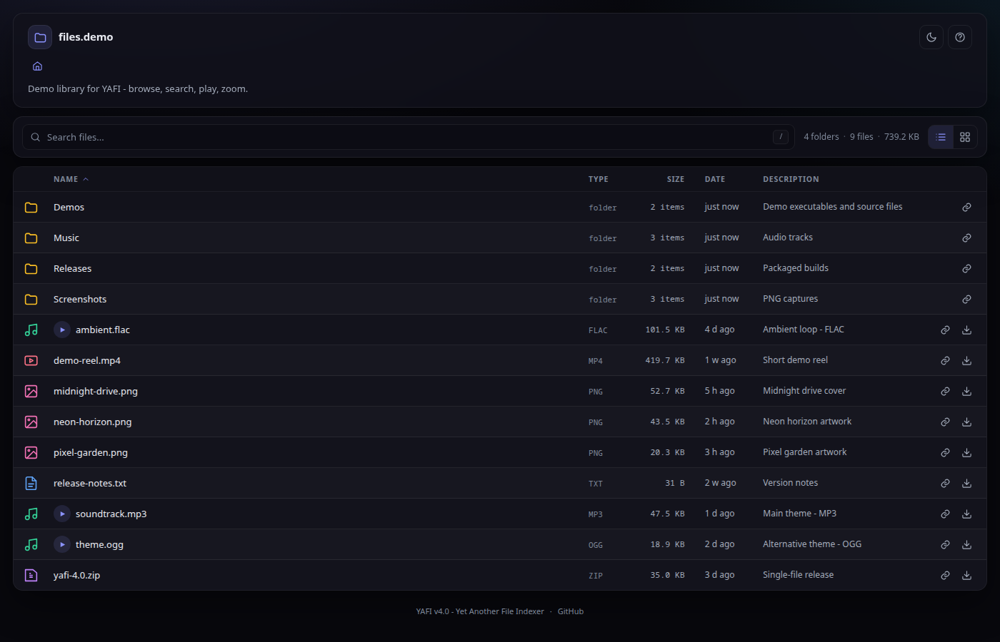
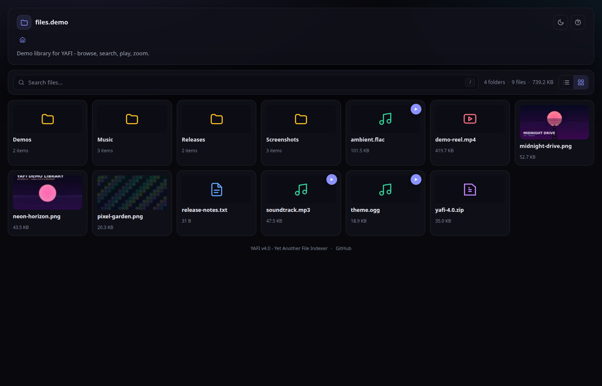
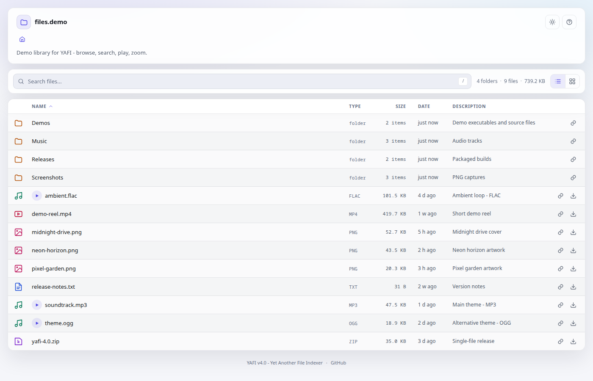
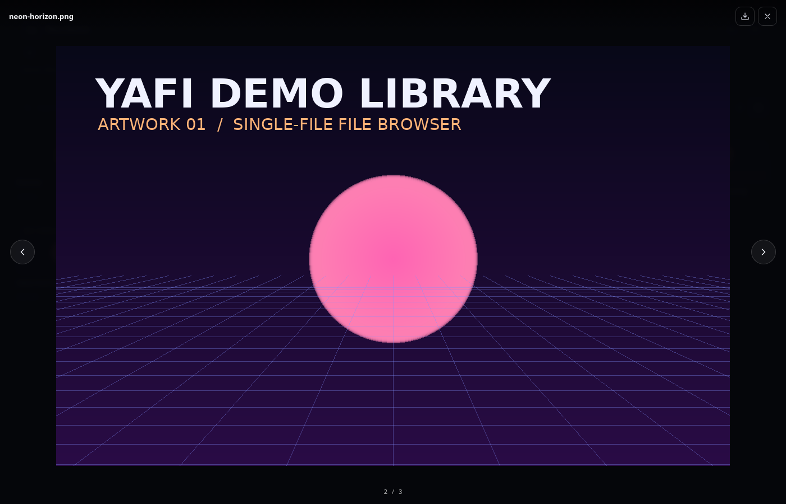
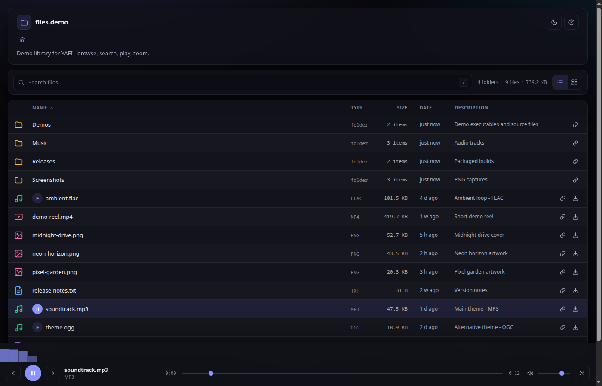

<p align="center">
  
</p>

<h1 align="center">YAFI</h1>

<p align="center">
  <strong>Yet Another File Indexer</strong><br>
  A fast, secure, single-file PHP file browser with built-in audio and image players.
</p>

<p align="center">
  Drop one <code>index.php</code> into a directory and get a clean, searchable, responsive listing.
</p>

<p align="center">
  <a href="https://github.com/N0NameN0/YAFI"></a>
  <a href="https://www.php.net/"></a>
  <a href="LICENSE"></a>
  
  
  
  
</p>

<p align="center">
  <a href="https://github.com/N0NameN0/YAFI">GitHub</a> ·
  <a href="#why-yafi">Why YAFI</a> ·
  <a href="#screenshots">Screenshots</a> ·
  <a href="#quick-start">Quick start</a> ·
  <a href="#configuration">Configuration</a> ·
  <a href="#security">Security</a> ·
  <a href="#deployment">Deployment</a>
</p>

---

**YAFI - Yet Another File Indexer** is a modern rewrite of the classic [snif](https://www.bitfolge.de/) 1.5.2 file browser. It turns any readable directory into a fast, good-looking file listing with natural sorting, instant search, thumbnails, an audio player and a pixel-perfect image viewer.

**Repository:** <https://github.com/N0NameN0/YAFI>

Yes, another file indexer - but this one is a single file, has no database, no Composer, no build step, no CDN and no tracking. Copy `index.php` into an existing directory and it is ready.

It is a good fit for:

- release archives and download directories;
- internal file shares and self-hosted libraries;
- screenshot, artwork and music collections;
- private file indexes protected by your web server.

> **Status:** stable, version **4.0**. The application is read-only: it lists, previews and downloads files. It does not upload, rename or delete anything.

## Why YAFI?

The original snif was a clever single-file browser, but it predates modern PHP and browser security expectations. YAFI keeps the deployment model that made snif useful while rebuilding the parts that matter:

- **One file to deploy.** The runtime is `index.php`; README and screenshots are optional.
- **Security first.** Path containment, symlink checks, protected-directory handling, safe headers and CSP are built in.
- **Modern UI.** Responsive layout, dark/light themes, list and grid views, accessible controls and keyboard shortcuts.
- **Real media support.** Browser-supported audio gets a playlist and waveform; images get a gallery, zoom and pan.
- **No external requests.** System fonts, inline SVG icons, inline CSS/JS. The page works offline once loaded.
- **Large directories are manageable.** Natural sorting, search, pagination, lazy thumbnails and optional directory scans.

## At a glance

| | |
|---|---|
| **Repository** | [github.com/N0NameN0/YAFI](https://github.com/N0NameN0/YAFI) |
| **Application** | Single-file PHP file browser |
| **Server** | PHP 8.1+; GD recommended for thumbnails |
| **Storage** | Filesystem only - no database |
| **UI** | Dark / light / system, list / grid, responsive |
| **Media** | Audio playlist, waveform, image gallery, 2000% zoom |
| **i18n** | English by default; French and German selectable in config |
| **License** | GPL-2.0-or-later |

## Screenshots

<p align="center">
  
  
</p>
<p align="center">
  
  
</p>

> The screenshots use a demo library with generated artwork and audio. Your folder names and files replace everything.

## Table of contents

- [Why YAFI?](#why-yafi)
- [At a glance](#at-a-glance)
- [Screenshots](#screenshots)
- [Features](#features)
- [Quick start](#quick-start)
- [Requirements](#requirements)
- [Configuration](#configuration)
- [External configuration](#external-configuration)
- [File descriptions](#file-descriptions)
- [Audio player](#audio-player)
- [Image viewer](#image-viewer)
- [Security](#security)
- [Performance](#performance)
- [Keyboard shortcuts](#keyboard-shortcuts)
- [Internationalization](#internationalization)
- [Deployment](#deployment)
- [Troubleshooting](#troubleshooting)
- [Project structure](#project-structure)
- [Contributing](#contributing)
- [License](#license)
- [Credits](#credits)

## Features

### Browsing

- **List and grid views** with one-click switching; your choice is remembered.
- **Natural sorting** (`file2` before `file10`) by name, type, size, date or description.
- **Folders always first**, in both ascending and descending order.
- **Instant search** across the current page, including descriptions and file types.
- **Breadcrumb navigation** and an always-available parent link.
- **Pagination** with a real pager when `$usePaging` is enabled.
- **Directory item counts** and total size in the toolbar.
- **Hidden-file wildcards** (`*~`, `*.md`, `old*` by default).
- **`descript.ion` support** for per-file and per-directory descriptions.
- **Copy-link** action on every entry.
- **Symlink handling** that refuses targets outside the browsable root.
- **Empty-folder and no-results states** instead of a blank table.

### Media

- **Audio player** for every format the browser reports as playable, with:
  - per-track play/pause buttons in the listing and on grid cards;
  - previous/next track navigation;
  - live canvas waveform;
  - Media Session metadata and media-key support;
  - persistent volume;
  - pause folds the bottom bar away while keeping the track position; click the same track to resume;
  - decode-failure handling that removes a broken play affordance instead of leaving a dead control.
- **Image viewer** with:
  - fixed previous/next arrows at the screen edges, independent of image size;
  - mouse-wheel zoom from 100% to **2000%**, centred on the cursor;
  - **pixelated / nearest-neighbour** rendering while zoomed;
  - drag-to-pan when zoomed;
  - zoom factor preserved when moving between images, with each image recentred;
  - keyboard navigation and a download button;
  - square image corners.

### Interface

- **Dark, light and system themes**, with no flash on load.
- **Responsive layout** down to small phones.
- **Accessible labels, focus states, `aria-sort`, dialogs and live regions.**
- **Keyboard shortcuts dialog** and copy-link toast.
- **No external fonts, icons, scripts or styles by default.**
- **Progressive enhancement**: the list, links and downloads work without JavaScript; JS-only controls are hidden in a `<noscript>` block.

### Security & reliability

- Canonical **realpath containment** for browsing, downloads and thumbnails.
- **Symlink escape protection** for files and directories.
- Rejection of files inside **`.htaccess`-protected subdirectories**.
- **PHP source download blocking** with a configurable deny-list.
- Per-request **CSP nonce**, `nosniff`, frame protection, referrer policy and permissions policy.
- **No inline event handlers**; all output is context-escaped.
- Safe UTF-8 filenames and RFC 5987 `Content-Disposition` downloads.
- Atomic thumbnail writes and a private cache directory.

### Performance

- One SVG sprite instead of one inline icon per row.
- Grid view rendered from a compact JSON payload rather than duplicating the listing in HTML.
- Lazy-loaded, cached thumbnails; WebP when available.
- Conditional requests (ETag / 304) for thumbnails.
- No animated background and no third-party network requests.
- Optional pagination and directory item-count scanning for very large folders.

## Quick start

1. **Get `index.php`** from the repository and copy it into the directory you want to expose.

   ```bash
   git clone https://github.com/N0NameN0/YAFI.git
   cd YAFI
   cp index.php /srv/files/
   ```

   You can also copy just [`index.php`](https://github.com/N0NameN0/YAFI/blob/main/index.php) if you do not want the README and screenshots.

2. **Make sure PHP can read the directory** and, for thumbnails, write to the system temp directory (or configure `$thumbnailCacheDir`).

3. **Open it in a browser.** With the PHP built-in server:

   ```bash
   cd /srv/files
   php -S 127.0.0.1:8000
   # then open http://127.0.0.1:8000/
   ```

   With Apache, Nginx or any PHP-capable web server, simply place `index.php` in the directory and open that directory in your browser.

4. **Configure it** by editing the configuration block at the top of `index.php`, or by using an [external config file](#external-configuration).

> The PHP built-in server is convenient for local use and development. It is not intended as a production web server.

### First checks

- Open a subdirectory and confirm the breadcrumb/parent link works.
- Upload or copy an image and confirm the grid thumbnail appears.
- Click a browser-supported audio file and confirm the player opens.
- Open an image, test wheel zoom, drag pan and the fixed arrows.
- If the folder should be private, put authentication in front of it before sharing the URL.

## Requirements

| Component | Requirement |
|---|---|
| **PHP** | 8.1 or newer (tested on PHP 8.4) |
| **Web server** | Apache, Nginx, Caddy, LiteSpeed or the PHP built-in server |
| **PHP extensions** | `gd` optional for thumbnails; `exif` optional for JPEG orientation; `mbstring` recommended for UTF-8 |
| **Thumbnail support** | GD + WebP recommended; JPEG fallback is used automatically |
| **Storage** | Writable temp directory for the thumbnail cache, or set `$thumbnailCacheDir` |
| **Browser** | Any modern evergreen browser; list and downloads work without JavaScript |
| **Database** | None |

The application is a single file. No Composer packages, Node modules, build pipeline or external CDN are required.

> Without GD, image files are still listed and opened normally; the thumbnail endpoint falls back to serving the source image.

## Configuration

Configuration lives in a clearly marked block near the top of `index.php`. The variable names are intentionally compatible with the original snif where possible.

All settings are optional; the defaults are sensible for a general-purpose file browser.

### Browsing & content

| Variable | Default | Description |
|---|---|---|
| `$hiddenFilesWildcards` | `array("*~", "*.md", "old*")` | Wildcard names hidden from listings. `*` and `?` are supported. Add entries to hide more files. |
| `$allowSubDirs` | `true` | Allow browsing into subdirectories. |
| `$usePaging` | `0` | Number of entries per page. `0` lists everything; for large folders try `250`. |
| `$directDirectoryLinks` | `false` | Link folders directly to their directory URL instead of routing through `?path=`. |
| `$useBackForDirUp` | `true` | Show the parent entry as `[ back ]`; set to `false` to show `..`. |
| `$useDescriptionsFrom` | `"descript.ion"` | Description file name. Set to `""` to disable descriptions. |
| `$separationString` | `"\t"` | Field separator used in the description file. |
| `$descriptionFilenamesCaseSensitive` | `false` | Match description keys case-sensitively. |
| `$displayColumns` | `array("icon", "name", "type", "size", "date", "description")` | Table columns. `icon`, `name` and actions are always present; the others are optional. |
| `$tableWidth100Percent` | `true` | Use the full available width for the table. |
| `$descriptionColumnWidth` | `0` | Maximum description column width in pixels. `0` uses the built-in default. |
| `$truncateLength` | `50` | Maximum displayed filename length in characters (UTF-8 aware). Full names remain available in titles and the grid. |
| `$snifServer` | Detected host | Display name in the header. This is cosmetic; links are built from the request path. |
| `$snifDateFormat` | `"d-m-y"` | Default English date format. Language arrays define their own date formats. |

### Appearance, language & behaviour

| Variable | Default | Description |
|---|---|---|
| `$defaultTheme` | `"dark"` | `dark`, `light` or `auto`. The user's choice is stored in `localStorage`. |
| `$defaultView` | `"list"` | `list` or `grid`. The user's choice is stored in `localStorage`. |
| `$hideSelf` | `true` | Hide `index.php` itself from its own listing. |
| `$showDirItemCounts` | `true` | Scan subdirectories to show item counts. Set to `false` for faster listings on slow storage. |
| `$allowIndexing` | `false` | Allow search-engine indexing. Default adds `noindex` metadata and an `X-Robots-Tag` header. |
| `$debug` | `false` | Display PHP errors. **Never enable this in production.** |
| `$alwaysUseLanguage` | `"en"` | Interface language: `en` (default), `fr`, `de`, or `""` to auto-detect from `Accept-Language`. |
| `$externalStylesheet` | `""` | Optional extra stylesheet URL. Its origin is automatically allowed in the CSP, and the file is hidden from the listing. |
| `$externalConfig` | `""` | Optional PHP config file included before request handling. Relative paths are resolved from the script directory. |
| `$snifVersion` | `4.0` | Internal version string shown in the footer and generator metadata. The variable name is kept for compatibility. |

### Security & downloads

| Variable | Default | Description |
|---|---|---|
| `$allowPHPDownloads` | `false` | Allow downloading PHP source-like extensions. Keep disabled on public sites. |
| `$protectDirsWithHtaccess` | `true` | Treat a subdirectory containing `.htaccess` as protected: hide it and block PHP-mediated file access. |
| `$downloadDenyExtensions` | `php`, `php3`…`php8`, `phtml`, `pht`, `phar`, `phps`, `inc` | Extensions rejected by the download endpoint when `$allowPHPDownloads` is false. |

### Thumbnails

| Variable | Default | Description |
|---|---|---|
| `$useAutoThumbnails` | `true` | Generate thumbnails for previewable images. |
| `$cacheThumbnails` | `true` | Cache generated thumbnails. |
| `$thumbnailWidth` | `200` | Maximum thumbnail width in pixels. |
| `$thumbnailHeight` | `80` | Maximum thumbnail height in pixels. |
| `$thumbnailQuality` | `82` | WebP/JPEG quality. |
| `$thumbnailMaxPixels` | `20000000` | Refuse to decode images above this pixel count; the original image is served instead. |
| `$useWebPThumbnails` | `true` | Use WebP when GD supports it, otherwise JPEG. |
| `$thumbnailCacheDir` | system temp + `yafi-thumbs-<hash>` | Private cache directory. Must be writable by PHP. |
| `$thumbnailCacheMaxAge` | `2592000` | Age in seconds after which stale cache files may be cleaned (30 days). |

### Legacy / compatibility keys

These keys remain for drop-in compatibility with old snif configurations but are not used by the current renderer:

- `$hiddenFilesRegex` - the regex is built internally from `$hiddenFilesWildcards`.
- `$useExternalImages` - reserved from the original snif icon system.
- `$externalIcons` - reserved from the original snif icon system.

## External configuration

Keep local preferences out of the main file. Create a PHP file - preferably outside the public document root - and point `$externalConfig` at it:

```php
// /etc/yafi/config.php
<?php

$hiddenFilesWildcards[] = '*.psd';
$usePaging             = 250;
$defaultTheme           = 'auto';
$defaultView            = 'grid';
$showDirItemCounts      = false;
$allowIndexing          = false;
$debug                  = false;

// Optional: keep thumbnails in the application directory instead of /tmp
$thumbnailCacheDir = __DIR__ . '/.yafi-cache';
```

Then in `index.php`:

```php
$externalConfig = '/etc/yafi/config.php';
```

Relative paths are resolved from the directory containing `index.php`. The config is included before path validation and output, and any accidental output from it is discarded.

## File descriptions

YAFI understands the classic `descript.ion` format: one entry per line, a tab between the filename and its description.

```text
Demos	Demo executables and source files
Music	Audio tracks
Releases	Packaged builds
neon-horizon.png	Neon horizon wallpaper
soundtrack.mp3	Main theme - MP3
.	Demo library for YAFI
```

- Use a real **tab** as the separator unless you changed `$separationString`.
- Keys are case-insensitive by default.
- Use `.` as the filename key to describe the current directory; it appears under the header.
- The description file itself is hidden from the listing automatically.
- Descriptions are escaped on output, so HTML is displayed as text.
- When `$useDescriptionsFrom` is empty, the description column is removed.

## Audio player

Every audio file that the **browser** reports as playable gets a play control. The server advertises a candidate list; the client verifies it with `HTMLMediaElement.canPlayType()` and falls back to a normal file link for unsupported formats.

Candidate extensions include:

```text
mp3  mp2  ogg  oga  opus  spx  wav  wave  flac
m4a  m4b  m4p  aac  weba  aif  aiff  aifc  caf  alac
```

Support varies by browser and operating system. For example, Chromium generally plays MP3, OGG/Opus, WAV, FLAC, AAC/M4A and WebM audio; AIFF and CAF may only appear in browsers that support them. WMA and MIDI are intentionally not advertised as playable.

### Player behaviour

- A small play/pause button appears before the filename and on audio grid cards.
- The bottom player shows track name, format, elapsed/total time, seek bar, volume and a live waveform.
- Previous/next skip unsupported tracks.
- **Pause folds the player away** but keeps the track and position; click the same track again to resume.
- The **×** button closes the session and releases the source, so the next play starts from the beginning.
- Media Session metadata and media keys work where supported.
- Volume is persisted in `localStorage`.
- If decoding fails despite the capability check, the track is paused, an error message is shown, and the unusable play affordance is removed.

### No transcoding

Files are served directly by your web server. Make sure common audio MIME types are configured correctly (`audio/mpeg`, `audio/ogg`, `audio/flac`, `audio/mp4`, `audio/wav`, etc.). YAFI does not transcode media.

## Image viewer

Click any previewable image to open the gallery.

- **Fixed arrows** sit at the left and right edges of the viewer and never move with the image size.
- **Mouse wheel** zooms between 100% and **2000%**, centred on the cursor.
- Zoomed rendering is **pixelated / nearest-neighbour**: no smoothing or anti-aliasing.
- **Drag** the image to pan when zoomed.
- The current zoom percentage appears next to the image counter.
- The **zoom factor is preserved** when you move to the previous/next image; the new image is recentred.
- Zoom resets when the viewer is closed.
- `←` and `→` navigate the gallery; `Esc` closes it.
- A download button saves the original image.
- Image corners are square by design.

## Security

YAFI is designed to be safer by default than the original single-file browsers, but it is still a file server UI. Treat deployment as a security decision.

### What is enforced

- **Canonical path checks** using `realpath()` and root containment for browsing, downloads and thumbnails.
- **Symlink protection**: links pointing outside the browsable root are skipped; PHP routes resolve the real target before serving.
- **Traversal protection**: `..`, absolute paths, drive paths and encoded variants are rejected.
- **Hidden entries** are blocked from listings, downloads and thumbnails.
- **`.htaccess`-protected subdirectories** are hidden and blocked by PHP routes (when `$protectDirsWithHtaccess` is enabled).
- **PHP-like source downloads** are blocked by default (`$allowPHPDownloads = false`).
- **CSP with a per-request nonce**, `X-Content-Type-Options: nosniff`, `Referrer-Policy`, `X-Frame-Options`, `Permissions-Policy` and optional `X-Robots-Tag`.
- **No inline event handlers** and context-aware escaping for HTML attributes, URLs and JSON.
- **Safe download headers**, including RFC 5987 UTF-8 filenames.
- **Private thumbnail cache** with symlink/owner checks and atomic writes.
- **No page caching**: the HTML is sent with `Cache-Control: private, no-store` because it contains a fresh CSP nonce on every request.

### What it does not do

> [!IMPORTANT]
> YAFI is **not an authentication layer**. Anyone who can reach the URL can browse every file that is visible to the application. If the directory is private, put HTTP authentication or an access proxy in front of it. Do not rely on hidden filenames or an unguessable URL for security.

Direct file links are served by the web server, not by PHP. Your server-level access rules (Basic Auth, IP allow-lists, SSO proxy, etc.) apply to those links too, but an application-level login does not exist.

For public folders:

```apache
# Apache example - protect the entire served directory
AuthType Basic
AuthName "Private files"
AuthUserFile /etc/apache2/.htpasswd
Require valid-user
```

```nginx
# Nginx example
auth_basic           "Private files";
auth_basic_user_file /etc/nginx/.htpasswd;
```

### Recommended production checklist

- [ ] Serve over HTTPS.
- [ ] Put authentication in front of private folders.
- [ ] Keep `$allowPHPDownloads` set to `false`.
- [ ] Keep `$debug` set to `false`.
- [ ] Deny dotfiles and source/config files at the web-server level.
- [ ] Make sure the PHP process can read the files you want to expose.
- [ ] Give the PHP process a writable thumbnail cache directory, or accept inline thumbnail generation.
- [ ] Do not expose `.git`, editor backups or config files.
- [ ] Keep PHP and your web server patched.

## Performance

The application is intentionally small and does no work it does not need to do.

- One SVG sprite is reused for all file-type and UI icons.
- Grid cards are rendered once from a small JSON payload; the HTML does not contain two complete copies of the listing.
- Thumbnails are generated lazily and cached; WebP is used when possible.
- Thumbnail responses support ETag/304 and long private cache lifetimes.
- Search filtering is debounced with `requestAnimationFrame`.
- The page has no external font, icon, script or stylesheet requests.
- No background animation runs; the page is static once rendered.
- The HTML page itself is deliberately not cached because of the per-request CSP nonce. Thumbnails and static files are still cached normally.

### Very large directories

For folders with thousands of entries:

```php
$usePaging        = 250;   // paginate instead of generating every row
$showDirItemCounts = false; // skip scanning every subdirectory
```

Those two settings have the biggest impact. In a local PHP 8.4 test, a 2,000-entry listing rendered in roughly 20-25 ms; real-world numbers depend on storage, cache and PHP configuration.

### Thumbnail cache

By default, thumbnails go to a private directory under the system temp directory:

```text
/tmp/yafi-thumbs-<hash>
```

The cache is created with `0700` permissions, checked for symlinks and ownership, and written atomically. Old files are cleaned opportunistically after `$thumbnailCacheMaxAge` seconds. Set `$thumbnailCacheDir` to a persistent path if you want thumbnails to survive reboots.

## Keyboard shortcuts

| Shortcut | Action |
|---|---|
| `/` | Focus the search box |
| `G` | Switch to grid view |
| `L` | Switch to list view |
| `?` | Open the keyboard shortcuts dialog |
| `Esc` | Close a dialog / clear the search |
| `←` `→` | Previous / next image in the viewer |
| Mouse wheel | Zoom the image (100%-2000%) |
| Drag | Pan a zoomed image |
| Media keys | Play/pause/next/previous audio where the browser supports Media Session |

Shortcuts are ignored while typing in the search field or while a dialog is open.

## Internationalization

Built-in languages:

- English (`en`) - **default**
- French (`fr`)
- German (`de`)

YAFI is English by default, regardless of the visitor's browser language. To switch the whole interface to French, edit the configuration block:

```php
$alwaysUseLanguage = 'fr';
```

Use `'de'` for German. Set it to `""` if you want automatic detection from the visitor's `Accept-Language` header instead:

```php
$alwaysUseLanguage = '';
```

The `<html lang="...">` attribute follows the active language. Missing keys fall back to the English/key string, so partial translations are safe.

To add a language, copy one of the arrays in `$languageStrings` and translate the values. Keep the array keys unchanged, and set a matching `DATEFORMAT`. New UI strings added in future versions will fall back to English until translated.

## Deployment

> [!NOTE]
> GitHub Pages serves static files only. YAFI requires PHP, so use a PHP-capable host, a VPS, or run it locally.

### Apache

Place `index.php` in the directory to expose and make sure PHP files are executed there. Apache can enforce `.htaccess` authentication for subdirectories; YAFI also hides those directories when `$protectDirsWithHtaccess` is enabled.

A simple vhost fragment:

```apache
<Directory /srv/files>
    Options -Indexes
    AllowOverride AuthConfig
    Require all granted
</Directory>
```

If the folder is private, add the Basic Auth block from the [Security](#security) section.

### Nginx + PHP-FPM

Make sure `.php` requests reach PHP-FPM and static files are served normally:

```nginx
server {
    listen 443 ssl;
    server_name files.example.com;
    root /srv/files;
    index index.php;

    location / {
        try_files $uri $uri/ =404;
    }

    # Adjust the socket/version to your PHP-FPM installation.
    location ~ \.php$ {
        include fastcgi_params;
        fastcgi_param SCRIPT_FILENAME $document_root$fastcgi_script_name;
        fastcgi_pass unix:/run/php/php8.4-fpm.sock;
    }

    # Hide dotfiles (keep .well-known if you use it).
    location ~ /\.(?!well-known) {
        deny all;
    }
}
```

No rewrite rules are required: YAFI uses `index.php?path=...` for directory navigation and lets the web server serve files directly.

For private folders, add `auth_basic` and `auth_basic_user_file` as shown above.

### PHP built-in server

For local use only:

```bash
cd /path/to/files
php -S 127.0.0.1:8000
```

### Proxies and caching

The HTML response intentionally uses `Cache-Control: private, no-store` because the CSP nonce changes on every request. If you put a reverse proxy in front of YAFI, do not cache the HTML page. Thumbnail responses are separately cacheable.

### Permissions

- Directories must be readable by the PHP user.
- Files must be readable to be listed and downloaded.
- The thumbnail cache must be writable, or PHP will generate thumbnails in memory without caching.
- Do not make the served directory writable by the web server unless your application stack requires it.

## Troubleshooting

| Symptom | Likely cause / fix |
|---|---|
| No thumbnails | GD is missing, the image type is unsupported, or the cache directory is not writable. Check `$useAutoThumbnails` and `$thumbnailCacheDir`. |
| Audio has no play button | The browser does not report the format as playable. The file still opens/downloads normally. Check server MIME types. |
| A file that should be visible is missing | Check `$hiddenFilesWildcards`, leading dots, and `$protectDirsWithHtaccess`. |
| A directory with `.htaccess` disappears | That is intentional when `$protectDirsWithHtaccess` is `true`. Set it to `false` only if you understand the exposure. |
| Download returns 404 | The file is hidden, outside the root, or has a blocked PHP-like extension. |
| Page is blank / HTTP 500 | Temporarily set `$debug = true`, check PHP error logs, and confirm PHP 8.1+ and required extensions. |
| Huge folders are slow | Set `$usePaging` (for example `250`) and `$showDirItemCounts = false`. |
| Zoom looks smoothed | Hard-refresh once (`Ctrl+Shift+R`). Version 4.0+ resizes the image for nearest-neighbour rasterisation. |
| Uploads/deletes do not work | YAFI is intentionally read-only. |

## Project structure

```text
.
├── index.php              # the whole application
├── README.md              # this file
├── LICENSE                # GPL-2.0 license text
└── docs/
    ├── preview-list.png
    ├── preview-grid.png
    ├── preview-light.png
    ├── preview-lightbox.png
    └── preview-player.png
```

`docs/` contains README screenshots only; it is not required at runtime. The application itself has no other runtime files.

## Contributing

Contributions, bug reports and security reports are welcome.

- Source, issues and pull requests: [github.com/N0NameN0/YAFI](https://github.com/N0NameN0/YAFI)
- Keep the application **single-file** and dependency-free at runtime.
- Keep the existing configuration variable names where possible.
- Preserve PHP 8.1+ compatibility.
- Avoid inline event handlers and unescaped output; follow the existing security patterns.
- Test at least list/grid, search, pagination, dark/light themes, the image viewer and the audio player.
- Test on desktop and a narrow mobile viewport.
- If you change CSP, nonce handling or caching, verify normal reloads in a real browser.

For a security issue, please avoid publishing exploit details in a public issue; report it privately to the maintainer.

## License

This project is released under the **GNU General Public License, version 2 or later** (GPL-2.0-or-later). See [LICENSE](LICENSE).

It is a derivative of **snif 1.5.2** by Kai Blankenhorn, which is distributed under the same license. The original attribution is preserved in the source header and in [Credits](#credits).

## Credits

- **YAFI - Yet Another File Indexer** - Antoine Santo aka **N0NameN0** (2026 modernization).
- **Repository** - [github.com/N0NameN0/YAFI](https://github.com/N0NameN0/YAFI).
- **Original snif** - Kai Blankenhorn, [www.bitfolge.de](https://www.bitfolge.de/).
- Icons are hand-drawn inline SVG; no third-party icon pack is bundled.
- Built with vanilla PHP, CSS and JavaScript. No framework, database, CDN or tracker.

<p align="center"><sub>Made for people who still like a good directory listing.</sub></p>
